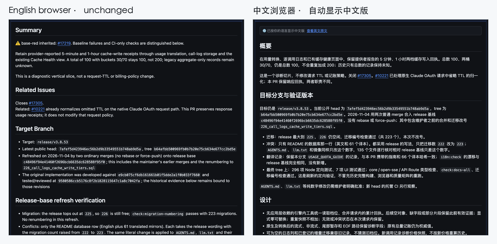
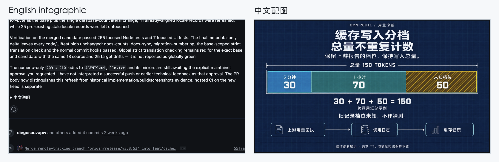
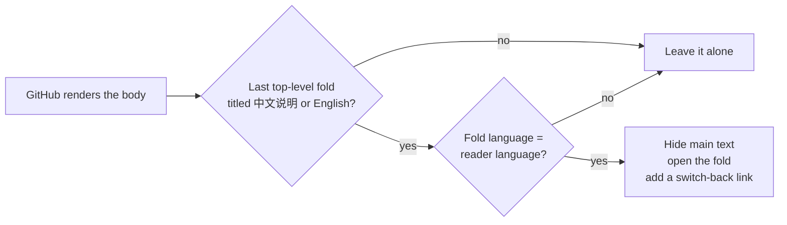

<div align="center">


# GitHub Bilingual

**Write each GitHub issue and PR once, in two languages. Every reader sees their own language first.**

[](LICENSE)


English · [简体中文](README.zh-CN.md)

</div>

---

GitHub can't switch a post's language for the reader. An issue body is just
Markdown, so English-speaking maintainers and Chinese-speaking users end up
scrolling past a wall of text in the other language.

This project solves that in two halves:

- 🧩 **A browser extension / userscript** for readers: on any GitHub issue,
  PR or comment written in this format, it shows the version that matches your
  browser language and adds a one-click link back to the original.
- 🤖 **An agent skill** for writers: it teaches your coding agent (Claude Code,
  Codex, Cursor, DeepSeek Harness, Antigravity, Hermes and others) to write
  bilingual bodies in this format, and includes a checker that runs before
  `gh issue create`.

Readers without the extension still see a normal post: the main text first, and
the full translation in a collapsed section underneath. Nothing about the post
depends on the extension.

## ✨ What it looks like

The same pull request, opened in two browsers:



Each half carries its own images, so diagrams get translated too:



## 📐 The format

```markdown
## Summary
English main text, complete, with its images.

Closes #42

<details>
<summary>中文说明</summary>

## 概述
完整的中文正文和中文配图。

</details>
```

The only rule is the **fold title**. Use exactly `中文说明` when the folded
half is Chinese, or exactly `English` when it is English (for Chinese-first
projects). The marker fold is the last top-level fold of the body. The
extension matches the title exactly and only switches a body whose last
top-level fold is a marker, so ordinary "Logs" or "Screenshots" folds never
trigger anything.

Why a visible title and not a hidden tag? GitHub strips HTML comments and
custom attributes from rendered Markdown, so the marker has to be text a human
can also read.

## 🚀 Quick start

### For readers: install the extension

**Chrome / Edge / Brave / Arc (unpacked)**

1. Download `github-bilingual-extension.zip` from the
   [latest release](https://github.com/xiaoyaner0201/github-bilingual/releases/latest) and unzip it.
2. Open `chrome://extensions`, turn on **Developer mode**.
3. Click **Load unpacked** and choose the unzipped folder.

**Tampermonkey / Violentmonkey (any browser)**

Install
[`github-bilingual.user.js`](https://raw.githubusercontent.com/xiaoyaner0201/github-bilingual/main/userscript/github-bilingual.user.js).
Your userscript manager will offer to install it.

By default it follows your browser language. To pin a language, use the
extension's toolbar popup, or the userscript manager menu
(*Follow browser / Always 中文 / Always English*).

### For writers: install the skill

With the cross-agent installer ([skills.sh](https://skills.sh)):

```bash
npx skills add xiaoyaner0201/github-bilingual            # this project only
npx skills add xiaoyaner0201/github-bilingual -g         # every project
npx skills add xiaoyaner0201/github-bilingual -a codex -a claude-code
```

Or install it with your agent's own command, or copy
`skills/github-bilingual/` into its skills directory:

| Agent | Install | Skill directory (user · project) |
|---|---|---|
| Claude Code | `/plugin marketplace add xiaoyaner0201/github-bilingual`, then `/plugin install github-bilingual@github-bilingual` | `~/.claude/skills/` · `.claude/skills/` |
| OpenAI Codex | `npx skills add … -a codex` | `~/.agents/skills/` · `.agents/skills/` |
| Cursor | `npx skills add … -a cursor` | `~/.cursor/skills/` · `.cursor/skills/` |
| DeepSeek Harness (dsh) | copy the folder | `~/.dsh/skills/` or `~/.agents/skills/` · `.dsh/skills/` or `.agents/skills/` |
| Google Antigravity | copy the folder | `~/.gemini/config/skills/` · `.agents/skills/` |
| Hermes Agent | `hermes skills install xiaoyaner0201/github-bilingual/skills/github-bilingual` | `~/.hermes/skills/` · `.hermes/skills/` |
| Gemini CLI | `gemini skills install https://github.com/xiaoyaner0201/github-bilingual.git` (add `--consent` to skip the prompt) | `~/.gemini/skills/` · `.gemini/skills/` |
| OpenCode | `npx skills add … -a opencode` | `~/.config/opencode/skills/` · `.opencode/skills/` |
| GitHub Copilot CLI | `npx skills add … -a github-copilot` | `~/.copilot/skills/` · `.github/skills/` |
| Windsurf | `npx skills add … -a windsurf` | `~/.codeium/windsurf/skills/` · `.windsurf/skills/` |

Several of these agents (Codex, Cursor, dsh, Gemini CLI, Copilot CLI, OpenCode,
Windsurf) also read the shared `~/.agents/skills/` and `.agents/skills/`
folders, so one copy there covers all of them. The skill
is a plain `SKILL.md` folder (the open Agent Skills format), so any other agent
that reads that format works too.

Then just ask: *"open a PR for this, bilingual"*.

## 🛠️ The checker

The skill ships a dependency-free script (Python 3.8+) your agent runs before
publishing:

```bash
python3 skills/github-bilingual/scripts/bilingual_body.py check body.md
python3 skills/github-bilingual/scripts/bilingual_body.py normalize old.md -o new.md
python3 skills/github-bilingual/scripts/bilingual_body.py swap body.md -o body.md
```

- `check`: exactly one marker fold, at the top level, last, with the blank lines
  GitHub needs. Closing keywords such as `Closes #42` must stay in the main
  text.
- `normalize`: upgrades old labels (`English summary`, `中文版`, …) and merges a
  separate translated-image fold into the marker fold.
- `swap`: makes the folded language the main text, for example when a project
  asks for English first.

## 🔍 How it works



- Runs only on `github.com` and needs only the `storage` permission. The
  switching code makes no network requests (your userscript manager may check
  the update URL, and Chrome may sync your language choice across devices).
- Never touches the editor or Markdown preview while you are writing a post.
- Each comment is decided on its own. It also handles GitHub's in-page
  navigation, so new comments switch as they load.
- Simplified and Traditional Chinese browsers (`zh-CN`, `zh-TW`, `zh-HK`) are
  all treated as Chinese.

## 🧪 Development

```bash
npm install
npm test              # DOM tests (jsdom) + checker tests
npm run build         # regenerate extension/core.js and the userscript from src/core.js
npm run package       # dist/github-bilingual-extension.zip
CHROMIUM_PATH=/path/to/chromium npm run test:e2e   # load the real extension on a live PR
```

`src/core.js` is the only source of the switching logic; the extension and the
userscript are generated from it.

## 🗺️ Roadmap

- Chrome Web Store and Firefox Add-ons listings
- More language pairs (the marker table is one line per language)

## License

[MIT](LICENSE)
