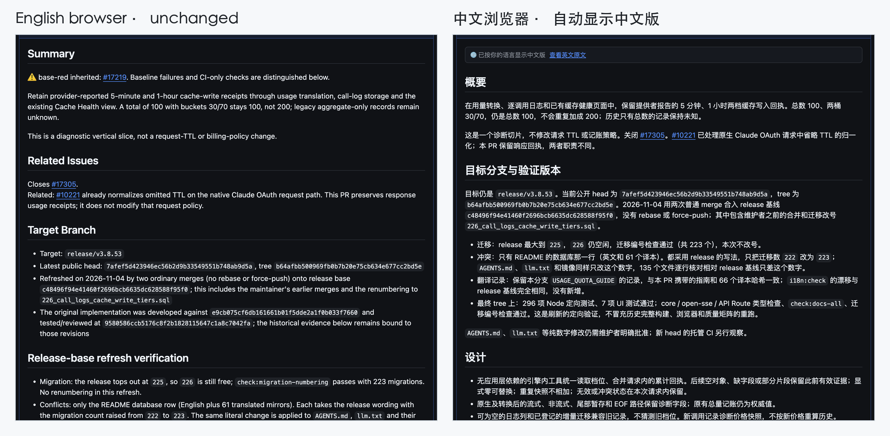
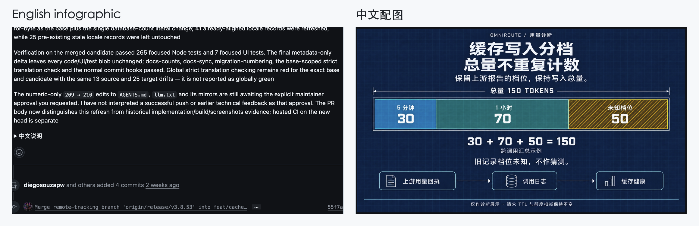
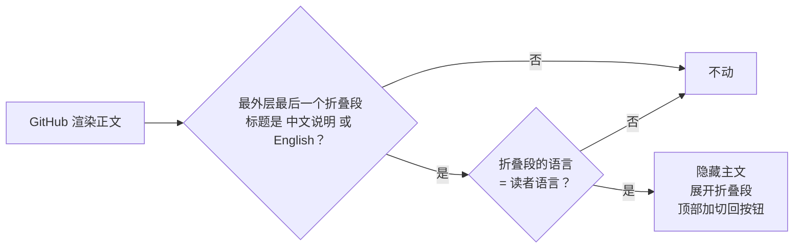

<div align="center">


# GitHub Bilingual

**一篇 Issue 或 PR 正文同时放中英两版，读者先看到自己的语言。**

[](LICENSE)


[English](README.md) · 简体中文

</div>

---

给开源项目提 Issue 和 PR 时，经常碰到这种两难：维护者看英文，社区里很多人看中文。只写一种语言，总有一半人读着费劲。两种都写，GitHub 又不会按读者切换，大家都得先翻过一整段自己不需要的内容。

这个项目从两头解决：

- 🧩 **浏览器插件 / 油猴脚本**（给读的人）：打开按约定格式写的 Issue、PR 或评论，自动显示和你浏览器语言一致的那一版，顶上留一个「查看原文」的按钮
- 🤖 **Agent Skill**（给写的人）：让你的编程 Agent（Claude Code、Codex、Cursor、DeepSeek Harness、Antigravity、Hermes 等）按这个格式写双语正文，发布前还能用自带的检查脚本过一遍

没装插件的人看到的也是一篇正常的帖子：主文在前，完整译文折叠在下面。帖子本身不依赖插件。

## ✨ 效果

同一个 PR，用两种语言的浏览器打开：



两版各配各的图，说明图也能跟着换语言：



## 📐 格式约定

```markdown
## Summary
英文主文，完整，带英文配图。

Closes #42

<details>
<summary>中文说明</summary>

## 概述
完整的中文正文和中文配图。

</details>
```

只有一条硬规定：**折叠段的标题**。折叠的是中文就写 `中文说明`，折叠的是英文就写 `English`（中文优先的项目用这种）。一个字都不能多，而且这个折叠段要放在正文最外层的最后。插件按整个标题精确匹配，只在最后一个折叠段是标记时才切换，所以帖子里别的折叠段，比如「Logs」「截图」，都不会触发。

为什么不用隐藏标记？GitHub 渲染时会删掉 HTML 注释和自定义属性，所以标记只能是看得见的文字，正好人也读得懂。

## 🚀 快速开始

### 读的人：装插件

**Chrome / Edge / Brave / Arc（开发者模式加载）**

1. 在[最新 Release](https://github.com/xiaoyaner0201/github-bilingual/releases/latest) 下载 `github-bilingual-extension.zip` 并解压
2. 打开 `chrome://extensions`，打开右上角的「开发者模式」
3. 点「加载已解压的扩展程序」，选解压出来的文件夹

**油猴 Tampermonkey / Violentmonkey（任何浏览器）**

点开
[`github-bilingual.user.js`](https://raw.githubusercontent.com/xiaoyaner0201/github-bilingual/main/userscript/github-bilingual.user.js)，油猴会弹出安装页。

默认跟随浏览器语言。想固定某种语言，点工具栏里的插件图标切换；油猴脚本在油猴菜单里切（跟随浏览器 / 总是中文 / 总是英文）。

### 写的人：装 Skill

用跨 Agent 的安装器（[skills.sh](https://skills.sh)）：

```bash
npx skills add xiaoyaner0201/github-bilingual            # 只装到当前项目
npx skills add xiaoyaner0201/github-bilingual -g         # 装到全局，所有项目可用
npx skills add xiaoyaner0201/github-bilingual -a codex -a claude-code
```

也可以用各家自己的命令装，或者直接把 `skills/github-bilingual/` 拷进对应目录：

| Agent | 安装方式 | Skill 目录（全局 · 项目） |
|---|---|---|
| Claude Code | 先 `/plugin marketplace add xiaoyaner0201/github-bilingual`，再 `/plugin install github-bilingual@github-bilingual` | `~/.claude/skills/` · `.claude/skills/` |
| OpenAI Codex | `npx skills add … -a codex` | `~/.agents/skills/` · `.agents/skills/` |
| Cursor | `npx skills add … -a cursor` | `~/.cursor/skills/` · `.cursor/skills/` |
| DeepSeek Harness（dsh） | 拷贝目录 | `~/.dsh/skills/` 或 `~/.agents/skills/` · `.dsh/skills/` 或 `.agents/skills/` |
| Google Antigravity | 拷贝目录 | `~/.gemini/config/skills/` · `.agents/skills/` |
| Hermes Agent | `hermes skills install xiaoyaner0201/github-bilingual/skills/github-bilingual` | `~/.hermes/skills/` · `.hermes/skills/` |
| Gemini CLI | `gemini skills install https://github.com/xiaoyaner0201/github-bilingual.git`（加 `--consent` 跳过确认） | `~/.gemini/skills/` · `.gemini/skills/` |
| OpenCode | `npx skills add … -a opencode` | `~/.config/opencode/skills/` · `.opencode/skills/` |
| GitHub Copilot CLI | `npx skills add … -a github-copilot` | `~/.copilot/skills/` · `.github/skills/` |
| Windsurf | `npx skills add … -a windsurf` | `~/.codeium/windsurf/skills/` · `.windsurf/skills/` |

Codex、Cursor、dsh、Gemini CLI、Copilot CLI、OpenCode、Windsurf 还会读公共的 `~/.agents/skills/` 和 `.agents/skills/`，放一份这些 Agent 都能用上。Skill 本身是标准的 `SKILL.md` 目录（开放的 Agent Skills 格式），其他支持这个格式的 Agent 也能直接用。

装好后直接说一句「帮我提个 PR，中英双语」就行。

## 🛠️ 检查脚本

Skill 里带一个零依赖的脚本（Python 3.8 以上），Agent 发布前会先跑一遍：

```bash
python3 skills/github-bilingual/scripts/bilingual_body.py check body.md
python3 skills/github-bilingual/scripts/bilingual_body.py normalize old.md -o new.md
python3 skills/github-bilingual/scripts/bilingual_body.py swap body.md -o body.md
```

- `check`：确认只有一个标记折叠段、在最外层、排在最后，空行也符合 GitHub 的渲染要求；`Closes #42` 这类关闭关键词只能写在主文里
- `normalize`：把老写法（`English summary`、`中文版` 等）改成标准标题，单独折叠的译文配图合并进标记折叠段
- `swap`：把折叠的语言换成主文，比如项目要求英文在前时用

## 🔍 工作原理



- 只在 `github.com` 上运行，只申请 `storage` 一个权限。切换逻辑本身不发网络请求（油猴可能会检查脚本更新地址，Chrome 可能在你的设备间同步语言设置）
- 你在写帖子时的编辑框和预览不会被改动
- 每条评论单独判断；GitHub 页内跳转、评论陆续加载时也会跟着切换
- 简体、繁体中文浏览器（`zh-CN`、`zh-TW`、`zh-HK`）都按中文处理

## 🧪 开发

```bash
npm install
npm test              # DOM 测试（jsdom）+ 检查脚本测试
npm run build         # 从 src/core.js 生成 extension/core.js 和油猴脚本
npm run package       # 打包 dist/github-bilingual-extension.zip
CHROMIUM_PATH=/path/to/chromium npm run test:e2e   # 在真实 PR 页面上加载扩展做端到端测试
```

切换逻辑只有 `src/core.js` 一份，插件和油猴脚本都是从它生成的。

## 🗺️ 后续计划

- 上架 Chrome 应用商店和 Firefox 附加组件
- 支持更多语言（标记表里每种语言只要加一行）

## 许可证

[MIT](LICENSE)
